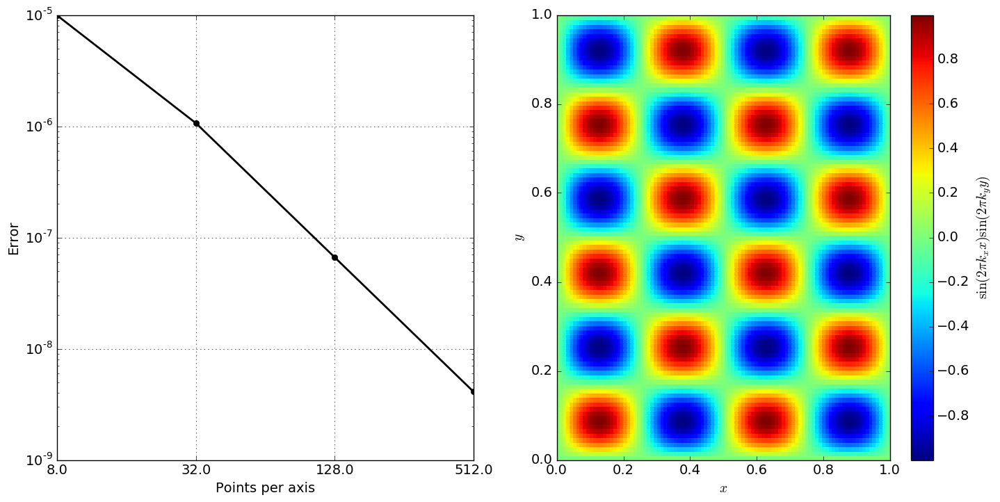
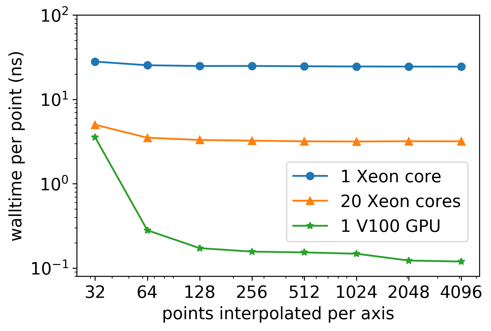

Spiner
===

<!-- Generative AI was used to assist with modifications to this file. -->

[](https://github.com/lanl/spiner/actions/workflows/tests.yml)

[](https://zenodo.org/badge/latestdoi/340131542)

[](https://doi.org/10.21105/joss.04367)

Performance portable utilities for representing and interpolating
tabulated data. Named for [Brent
Spiner](https://en.wikipedia.org/wiki/Brent_Spiner). For full documentation, see [here](https://lanl.github.io/spiner/main/index.html).

## Performance portability

`Spiner` is compatible with code on CPU, GPU, and everything in between. We use [ports-of-call](https://lanl.github.io/ports-of-call/main/index.html) for this feature.

## Building and Installation

`Spiner` is header-only and requires C++20, CMake 3.24 or newer, and
Ports-of-Call 3.1.1 or newer. Clone it as
```bash
git clone --recursive git@github.com:lanl/spiner.git
```
To build and run unit tests,
```bash
cd spiner
cmake -S . -B bin -DSPINER_BUILD_TESTS=ON -DSPINER_TEST_USE_KOKKOS=OFF
cmake --build bin --parallel 6
ctest --test-dir bin --output-on-failure -j 6
```
and to do convergence testing,
```bash
cmake --build bin --target convergence --parallel 6
```
after building.

To install,
```bash
cmake --install bin --prefix /path/to/install
```
after configuring and building.

### Build options

- `SPINER_USE_HDF` enables or disables HDF5. Default is `OFF`
- `SPINER_TEST_USE_KOKKOS` enables Kokkos for tests; defaults to `ON` when tests are enabled.
- `SPINER_TEST_USE_KOKKOS_CUDA` enables CUDA for the fetched test Kokkos; default is `ON`.
- `SPINER_USE_PORTABLE_NQT` selects portable NQT functions; default is `OFF`.
- `SPINER_BUILD_TESTS` enables or disables tests. Default is `OFF`. If
  this is disabled, then configuration *only* prepares for install and
  provides targets for in-tree builds, as no build step is necessary.
- `CMAKE_PREFIX_PATH` supplies installation prefixes for dependency discovery.
- `FETCHCONTENT_SOURCE_DIR_<NAME>` supplies an existing dependency source tree,
  for example `FETCHCONTENT_SOURCE_DIR_KOKKOS`.

## Including spiner in your project

You can build `spiner` in-line with your project, or pre-install
it. It's header-only and the include directories should have the
expected structure. If you build inline, add the following target to your `cmake`:
```cmake
target_link_libraries(my_project PRIVATE spiner::spiner)
```

## Dependencies

`Spiner` relies on [ports-of-call](https://lanl.github.io/ports-of-call/main/index.html)
3.1.1 or newer for performance portability. CMake first searches installed
packages and fetches the pinned dependency when no compatible package is found.
When integrating without CMake, provide both the complete `spiner/` header
directory and Ports-of-Call headers.

The testing tooling requires a few different pieces:

- Unit testing requires [Catch2](https://github.com/catchorg/Catch2),
  which is downloaded automatically if needed.
- Convergence testing requires the scientific python stack, including:
  - python3
  - numpy
  - matplotlib

### HDF5

`Spiner` supports reading and writing DataBox objects into a custom HDF5 format called `SP5`. 
To enable this, compile with the appropriate `HDF5` linking and the flag `-DSPINER_USE_HDF`.
If you use the cmake build system, just configure with `-DSPINER_USE_HDF=ON`.

### CUDA and Kokkos

`Spiner` uses Ports-of-Call for portability. Test builds can use an installed
Kokkos discovered through `CMAKE_PREFIX_PATH`, or fetch Kokkos automatically.
For CUDA tests, configure with an appropriate CUDA compiler wrapper:

```bash
cmake -S . -B bin-cuda -DSPINER_BUILD_TESTS=ON \
  -DSPINER_TEST_USE_KOKKOS=ON -DSPINER_TEST_USE_KOKKOS_CUDA=ON \
  -DCMAKE_CXX_COMPILER=nvcc_wrapper
cmake --build bin-cuda --parallel 6
ctest --test-dir bin-cuda --output-on-failure -j 6
```

Set the appropriate Kokkos architecture options for your hardware. For CPU
Kokkos tests, set `SPINER_TEST_USE_KOKKOS_CUDA=OFF`.

### Clang-Format

Clang-format version 19 is required for committing, and a github
workflow is used to check that code meets format requirements. We
provide a make target in the build system. After configuration, simply
type
```bash
cmake --build bin --target format_spiner --parallel 6
```
to format the code.

Other versions of `clang-format` may work. If you would like to try,
please examine the diff and see if the formatting appears
stable. Otherwise, you may need to upgrade your version of
`clang-format`.

In general, we recommend formatting regularly so that the format calls
do not pollute the diffs. If a format call necessarily pollutes the
diff, do it as a separate commit.

## Features

- Spiner supports interpolation in arbitrary dimensions, and it's fast in 3d and fewer.
- Spiner supports interpolation onto "subtables"

## Interpolation

Interpolation is linear. Here's an example of interpolation in 3D (2D
slice shown). Convergence is second-order, as expected.



Interpolation is fast and portable. Here's performance on several
different problem sizes and several different architectures with
different parallelism strategies:



## Contributing

If you use Spiner and need help, submit an issue to the Spiner
repository. If you'd like to contribute, just fork and submit a pull
request. There's a check list in the PR template, and one of the main
Spiner developers will review your PR.

## Contributors

`Spiner` was primarily developed by Jonah Miller in collaboration with
- Chad Meyer
- Daniel Holladay
- Josh Dolence
- Sriram Swaminarayan

Continuous integration and build system support has been provided by
- Jonah Miller
- Karen Tsai
- Christopher Mauney

## Copyright

© (or copyright) 2019-2026. Triad National Security, LLC. All rights
reserved.  This program was produced under U.S. Government contract
89233218CNA000001 for Los Alamos National Laboratory (LANL), which is
operated by Triad National Security, LLC for the U.S.  Department of
Energy/National Nuclear Security Administration. All rights in the
program are reserved by Triad National Security, LLC, and the
U.S. Department of Energy/National Nuclear Security
Administration. The Government is granted for itself and others acting
on its behalf a nonexclusive, paid-up, irrevocable worldwide license
in this material to reproduce, prepare derivative works, distribute
copies to the public, perform publicly and display publicly, and to
permit others to do so.

This program is open source under the BSD-3 License.  Redistribution
and use in source and binary forms, with or without modification, are
permitted provided that the following conditions are met:
1. Redistributions of source code must retain the above copyright
notice, this list of conditions and the following disclaimer.
2. Redistributions in binary form must reproduce the above copyright
notice, this list of conditions and the following disclaimer in the
documentation and/or other materials provided with the distribution.
3. Neither the name of the copyright holder nor the names of its
contributors may be used to endorse or promote products derived from
this software without specific prior written permission.

THIS SOFTWARE IS PROVIDED BY THE COPYRIGHT HOLDERS AND CONTRIBUTORS
"AS IS" AND ANY EXPRESS OR IMPLIED WARRANTIES, INCLUDING, BUT NOT
LIMITED TO, THE IMPLIED WARRANTIES OF MERCHANTABILITY AND FITNESS FOR
A PARTICULAR PURPOSE ARE DISCLAIMED. IN NO EVENT SHALL THE COPYRIGHT
HOLDER OR CONTRIBUTORS BE LIABLE FOR ANY DIRECT, INDIRECT, INCIDENTAL,
SPECIAL, EXEMPLARY, OR CONSEQUENTIAL DAMAGES (INCLUDING, BUT NOT
LIMITED TO, PROCUREMENT OF SUBSTITUTE GOODS OR SERVICES; LOSS OF USE,
DATA, OR PROFITS; OR BUSINESS INTERRUPTION) HOWEVER CAUSED AND ON ANY
THEORY OF LIABILITY, WHETHER IN CONTRACT, STRICT LIABILITY, OR TORT
(INCLUDING NEGLIGENCE OR OTHERWISE) ARISING IN ANY WAY OUT OF THE USE
OF THIS SOFTWARE, EVEN IF ADVISED OF THE POSSIBILITY OF SUCH DAMAGE
